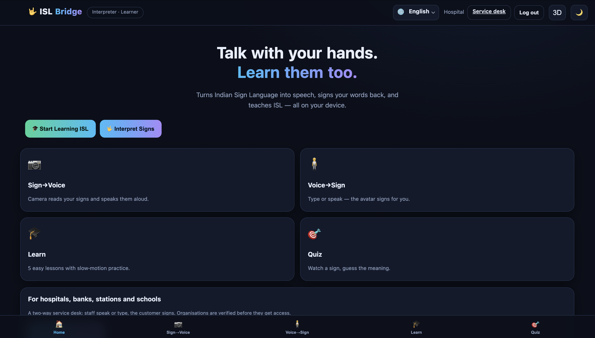
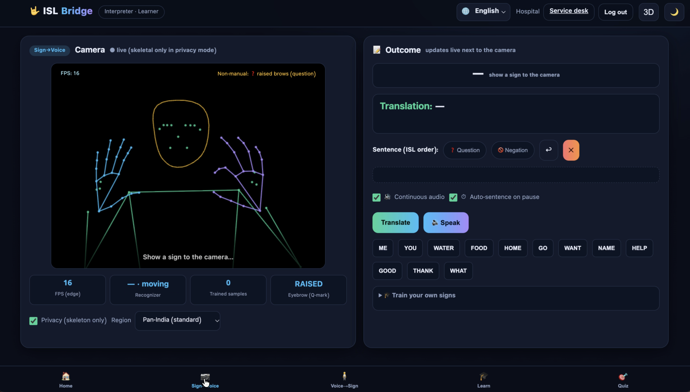
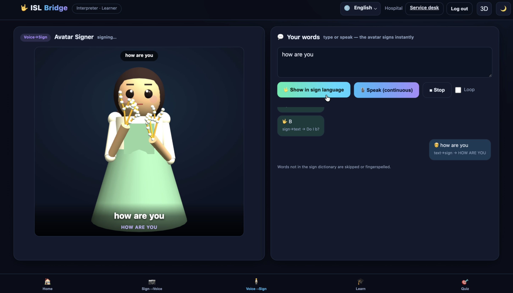
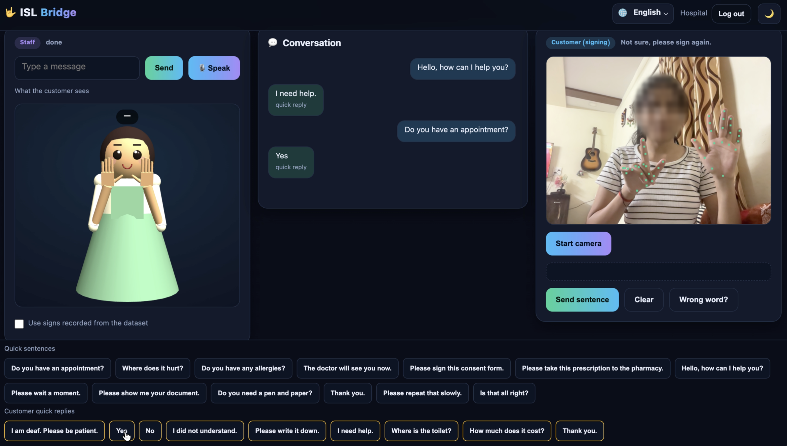
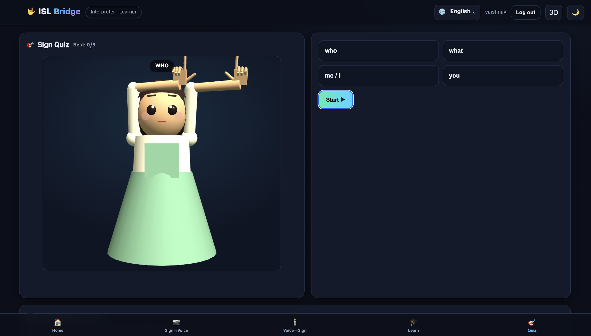
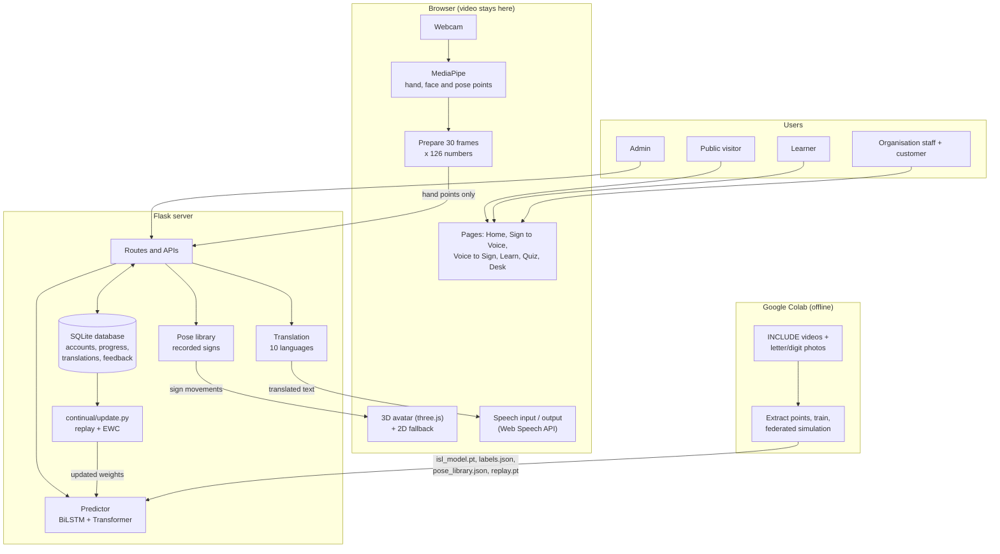
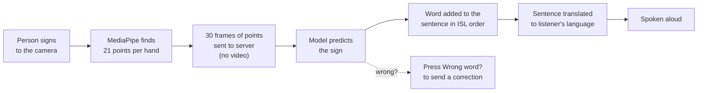
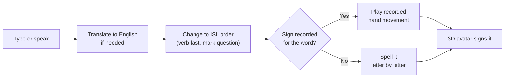
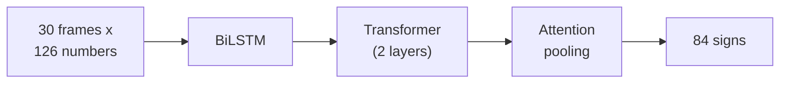

# ISL Bridge

Real-time Indian Sign Language translation using deep learning.

ISL Bridge is a website that turns Indian Sign Language (ISL) into speech, turns typed or spoken words into signs shown by a 3D avatar, and teaches ISL through lessons and quizzes.



## Why we made this

We wanted to reduce the communication gap between deaf and hearing people. A deaf person who goes to a hospital, bank or railway station usually needs someone to help them talk to the staff. We wanted to build something that lets them manage on their own, so they feel comfortable in public places.

We also wanted more people to learn sign language, so we added lessons and a quiz for both deaf and hearing users.

## System overview

ISL Bridge has four main parts.

**1. Sign to Voice.** The camera watches the signer. The browser finds the hand points, the AI model works out which sign it is, and the website speaks the word. Several signs are joined into a sentence.

**2. Voice to Sign.** The user types or speaks. The text is converted into ISL word order and a 3D avatar signs it. If a word has no recorded sign, the avatar spells it letter by letter.

**3. Service desk.** Made for hospitals, banks, stations and schools. Staff type or speak and the avatar signs for the customer. The customer signs to the camera and the sentence is spoken to the staff. Organisations must register and be approved by the admin first.

**4. Learn and Quiz.** Five lessons with slow-motion practice and a quiz where you watch a sign and pick its meaning. Progress and best scores are saved to the learner's account.

The whole site works in 10 languages: English, Hindi, Marathi, Bengali, Tamil, Telugu, Kannada, Malayalam, Gujarati and Punjabi.

The model recognises 84 signs: A to Z, 0 to 9 and 48 words such as hello, thank you, how are you, good morning, happy, sad, tall and strong.

## Screenshots

Sign to Voice



Voice to Sign



Service desk



Sign quiz



## System architecture

The project is split into three places: the browser, the Flask server, and Google Colab where the model is trained. The camera video is processed only in the browser. The server never receives video, only the hand points.



## Workflow

Sign to Voice:



Voice to Sign:



Service desk:

1. The organisation registers and the admin approves it at `/admin`.
2. Staff log in and open the desk.
3. Staff type or speak, and the avatar signs for the customer.
4. The customer signs to the camera and the sentence is spoken to the staff.
5. Quick sentences and quick replies speed up common questions, and everything shows in the conversation log.
6. If a word is recognised wrongly, staff press "Wrong word?" and choose the right one. Only the hand points and the right word are saved.

Learning from corrections: `continual/update.py` fine-tunes the model on the saved corrections. It mixes in a few old samples (replay buffer) and adds an EWC penalty so the model does not forget signs it already knew.

## The AI model

The model is in `model/isl_model.py`, written in PyTorch.



Each sign is 30 frames. Each frame has 126 numbers (2 hands x 21 points x x, y, z), made relative to the wrist so it does not matter where the person stands. The BiLSTM learns the small movements, the Transformer looks at the whole sign together, and attention pooling joins everything into one answer. The model has about 1.35 million parameters and the weights file is about 5.4 MB.

Training is done in `ISL_Bridge_Training.ipynb` on Google Colab, using the INCLUDE dataset (Greetings and Adjectives videos) plus photos of letters and digits. We split the data 70/15/15 for training, validation and testing, and used mirroring, noise, scaling and speed changes as augmentation. The notebook also simulates federated learning with 5 clients.

One problem we ran into: some word signs look like letter shapes, so the model kept picking letters. We fixed it by giving word classes more weight in training and boosting their score when predicting (`WORD_BOOST`).

## Results

The model was trained on 84 classes (48 words and 36 letters/digits) with the 70/15/15 train/validation/test split. Training stopped early at epoch 111, and the best checkpoint (best validation accuracy 94.8%) was kept.

### Test set performance

| Metric | Score | Test samples |
|---|---|---|
| Top-1 accuracy (all 84 classes) | **95.8%** | 289 |
| Top-5 accuracy | **98.3%** | 289 |
| Words only (48 classes) | 96.6% | 87 |
| Letters and digits only (36 classes) | 95.5% | 202 |

### Validation accuracy during training

| Epoch | Val accuracy | Best so far |
|---|---|---|
| 0 | 0.329 | 0.329 |
| 10 | 0.820 | 0.820 |
| 20 | 0.882 | 0.882 |
| 40 | 0.879 | 0.920 |
| 60 | 0.896 | 0.924 |
| 80 | 0.927 | 0.938 |
| 90 | 0.931 | 0.948 |
| 100 | 0.941 | 0.948 |
| 110 | 0.941 | 0.948 |

Validation accuracy rose from 32.9% at the start to about 94% by epoch 100. It stopped improving after epoch 90, so early stopping ended training at epoch 111.

### Example prediction

Prediction for a sample whose true label is `i`:

| Rank | Label | Confidence |
|---|---|---|
| 1 | i | 0.494 |
| 2 | curved | 0.017 |
| 3 | sad | 0.016 |

The correct sign is ranked first, well ahead of the alternatives. The confidence is spread across 84 classes, so even a correct answer can have a score below 0.5.

## Tech stack

| Area | What we used |
|---|---|
| Language | Python 3.10+, JavaScript, HTML, CSS |
| Deep learning | PyTorch (BiLSTM + Transformer) |
| Hand and face tracking | MediaPipe Holistic (in the browser) |
| Backend | Flask |
| Database | SQLite |
| 3D avatar | three.js (r128), plus a 2D canvas avatar |
| Speech | Browser Web Speech API |
| Translation | deep-translator |
| Training | Google Colab (GPU), scikit-learn, OpenCV |
| Dataset | INCLUDE (Zenodo) |

## Dependencies

Python packages, from `requirements.txt`:

```
flask==3.0.3
deep-translator==1.11.4
torch>=2.2
numpy
requests
```

Loaded in the browser from a CDN (internet needed):

- `@mediapipe/holistic` 0.5.1675471629 and `@mediapipe/camera_utils`
- `three.js` r128

Other requirements:

- Chrome or Edge (the camera and microphone work only on `localhost` or HTTPS)
- Internet for translation and for loading MediaPipe
- A voice pack for each language installed on the device, if you want speech in that language

## Repository structure

```
ISL-Bridge/
├── app.py                        Flask server: routes, login, database, translation, model APIs
├── requirements.txt              Python packages
├── ISL_Bridge_Training.ipynb     Colab notebook for training
├── .gitignore
├── README.md
├── model/
│   ├── isl_model.py              Network definition
│   ├── predictor.py              Loads the model and predicts
│   ├── isl_model.pt              Trained weights
│   ├── labels.json               The 84 sign names
│   ├── pose_library.json         Recorded hand movements for the avatar
│   └── replay.pt                 Old samples used for continual learning
├── continual/
│   └── update.py                 Learns from corrections
├── data/                         Interface text, languages, quizzes, desk sentences
├── templates/                    HTML pages (index, desk, auth, admin, layout)
├── static/
│   ├── css/style.css
│   └── js/                       app.js, avatar.js, avatar3d.js, gloss.js, i18n.js,
│                                 learn.js, desk.js, account.js
└── screenshots/                  Pictures used in this file
```

## How to run

```bash
git clone https://github.com/<vaishnavi3712>/ISL-Bridge.git
cd ISL-Bridge

python -m venv venv
source venv/bin/activate        # Windows: venv\Scripts\activate

pip install -r requirements.txt
python app.py
```

Open http://127.0.0.1:5000 in Chrome or Edge.

Before using it anywhere other than your own laptop, set two environment variables:

```bash
export SECRET_KEY="a long random text"
export ADMIN_KEY="the key you will type on /admin"
```

Organisations register at `/register/org`, and the admin approves them at `/admin`.

## Training the model again

1. Put the project zip in your Google Drive.
2. Open `ISL_Bridge_Training.ipynb` in Google Colab and choose a GPU runtime.
3. Run all cells. It downloads the dataset, trains the model and saves the new files into `model/`.

To improve the model from corrections (needs at least 5 saved corrections):

```bash
python continual/update.py
```

## Future work

- Recognise full sentences using sentence-level datasets such as ISLTranslate and iSign.
- Use the face and body as model input too.
- Add more words for medical, bank and travel use.
- Make the model small enough to run fully on a phone.
- Test it with deaf users and ISL teachers.

## Credits

- INCLUDE dataset, Sridhar et al., ACM Multimedia 2020: https://zenodo.org/records/4010759
- MediaPipe, PyTorch, three.js and Flask
- ISLRTC learning material: https://islrtc.nic.in

## Team

- Vaishnavi Vinod Chaudhari
- Snehal Sunil Bhusande
- Premraj Kishor Gite
- Aarati Purushottam Dhumale

Project guide: Prof. Priyanshi Borse
 Department of Artificial Intelligence and Machine Learning

Repository link: https://github.com/vaishnavi3712/ISL-Bridge
